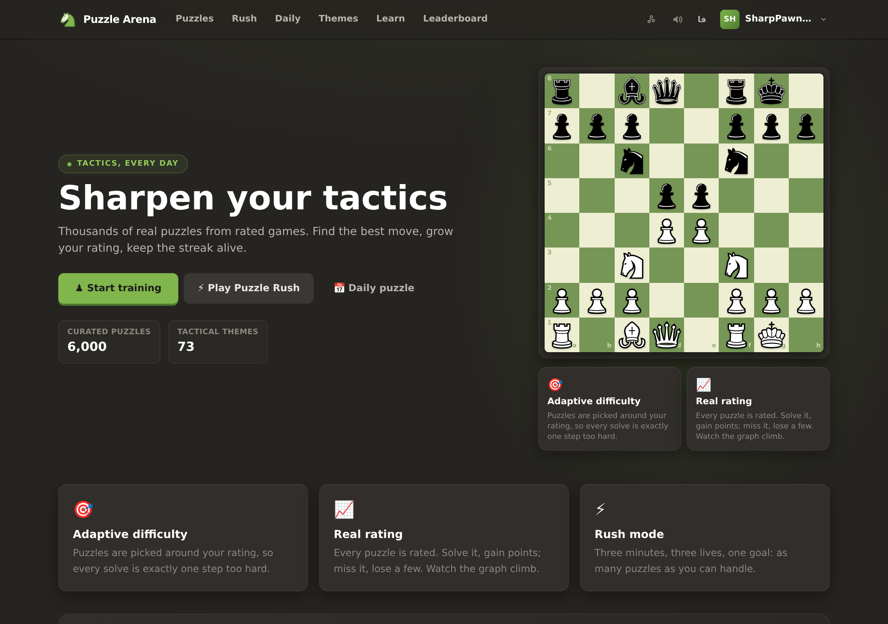
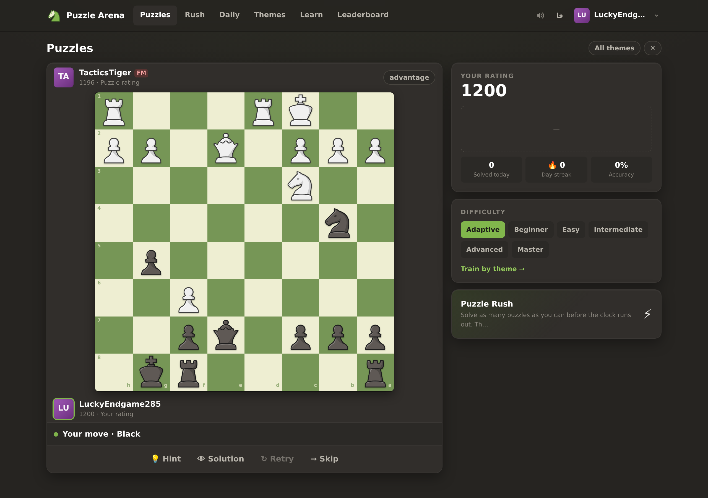
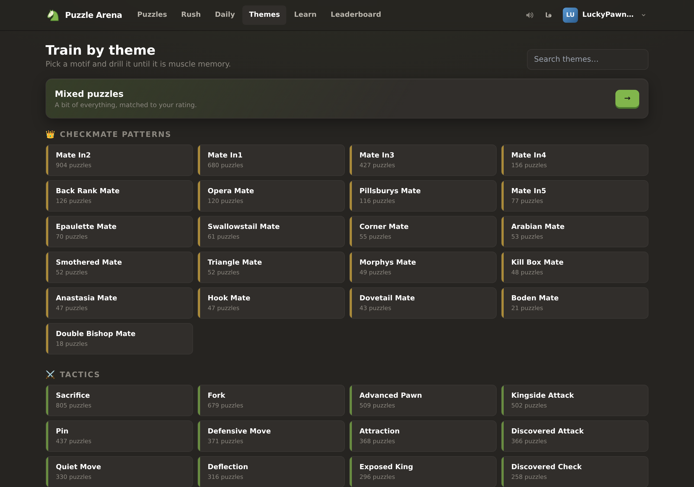

# ♟ Puzzle Arena

A **Chess.com-style chess puzzle trainer** — real positions, real ratings, puzzles, hints,
Puzzle Rush, a daily puzzle, themes, statistics and a leaderboard.

Built with **React 19 + TypeScript + Vite + Tailwind** on the front end and
**Node.js + Express 5 + SQLite** on the back end. 6,000 curated puzzles from the
Lichess puzzle database (CC0) are bundled, so it works out of the box.



---

## ✨ Features

| | |
|---|---|
| 🎯 **Adaptive puzzle trainer** | Puzzles are weighted by your rating, their popularity and how recently you saw them. |
| 🧠 **Server-side puzzle engine** | Solutions never reach the browser until they are earned — no cheating via DevTools. |
| 📈 **Elo rating** | Every puzzle is rated; solving counts as a win, missing as a loss (K=40 while provisional). |
| ⚡ **Puzzle Rush** | 1/3/5-minute runs, three lives, streaks, personal bests and a rush leaderboard. |
| 📅 **Daily puzzle** | One deterministic puzzle per UTC day for everybody, with streaks and a shareable result. |
| 🗂 **73 themes** | Mates in 1–5, forks, pins, skewers, discovered attacks, zugzwang, endgames, openings… |
| 🏅 **Move evaluation badges** | Chess.com-style icons pop up on the piece you just moved — `!!` Brilliant for sacrifices, `!` Great for quiet/defensive finds, `✓` Best — plus a “Brilliant!” banner and forced-move markers in the solution list. |
| 💡 **Progressive hints** | Hint 1 → which piece, hint 2 → the square it stands on, hint 3 → the full move (arrow). |
| 👤 **Accounts or guests** | JWT auth with bcrypt, or instant guest play — both are rated and tracked. |
| 🌍 **Bilingual UI** | English and Persian (فارسی) with full RTL layout support. |
| 🎨 **Neo-style pieces** | Flat, clean `staunty` artwork with crisp outlines on the classic green board. |
| 🔊 **Sound effects** | Tiny WebAudio synth (move, capture, check, success, fail) — no audio assets. |
| 📱 **Responsive** | Drag & drop or click-to-move, touch friendly, board scales to the viewport. |
| 🚀 **One-command deploy** | Express serves the built SPA, or ship the client to GitHub Pages. |

<p align="center">
  
  
</p>

---

## 🚀 Quick start

```bash
git clone https://github.com/<you>/chess-puzzle-arena.git
cd chess-puzzle-arena
npm install            # installs both workspaces

npm run dev            # API on :3001 + Vite dev server on :5173 (proxied)
```

Then open **http://localhost:5173**.

Production build (single port, served by Express):

```bash
npm run build          # builds client -> client/dist and server -> server/dist
npm start              # http://localhost:3001
```

Environment variables live in `.env` (see `.env.example`):

```ini
PORT=3001
JWT_SECRET=please-change-me
DB_FILE=./data/app.db
```

---

## 🧱 Project layout

```
chess-puzzle-arena/
├── client/                    # React 19 + Vite + Tailwind
│   ├── public/pieces/staunty/ # flat "neo"-style SVG pieces (CC BY-NC-SA 4.0)
│   └── src/
│       ├── components/        # Board, PuzzleBoard, Navbar, AuthModal, charts…
│       ├── hooks/usePuzzle.ts # the puzzle state machine (moves, hints, solution, retry)
│       ├── pages/             # Home, Puzzles, Rush, Daily, Themes, Profile, Leaderboard, Learn
│       ├── lib/               # api client, i18n (en/fa), WebAudio sounds
│       └── store/AppContext   # auth/session, stats, toasts
├── server/                    # Express 5 + better-sqlite3
│   └── src/
│       ├── puzzles.ts         # dataset loading, themed/adaptive picking, daily puzzle
│       ├── sessions.ts        # server-authoritative puzzle sessions (chess.js)
│       ├── rating.ts          # Elo
│       ├── routes/            # /auth, /puzzles, /rush, /leaderboard, /me/stats
│       └── db.ts              # schema + prepared statements
├── data/puzzles.json          # 6,000 curated puzzles (generated, committed)
├── scripts/build-puzzles.py   # dataset curation script
└── .github/workflows/         # CI + GitHub Pages deployment
```

---

## 🔌 API

| Method | Endpoint | Description |
|---|---|---|
| `POST` | `/api/auth/guest` | create a guest session → `{ token, user }` |
| `POST` | `/api/auth/register` · `/api/auth/login` | create account / sign in |
| `GET` | `/api/auth/me` | current user |
| `GET` | `/api/puzzles/meta` | dataset size, themes with counts |
| `GET` | `/api/puzzles/next?theme=&difficulty=` | start the next puzzle session |
| `POST` | `/api/puzzles/:id/move` | play `{ from, to, promotion? }` |
| `POST` | `/api/puzzles/:id/hint` | progressive hint (`level` 1–3) |
| `POST` | `/api/puzzles/:id/solution` | reveal the solution (ends the puzzle) |
| `POST` | `/api/puzzles/:id/retry` · `/skip` | retry / skip |
| `GET` | `/api/puzzles/daily` | today's puzzle + streak |
| `POST` | `/api/rush/start` · `/api/rush/:id/result` | rush runs |
| `GET` | `/api/me/stats` | rating history, accuracy, theme stats, recent activity |
| `GET` | `/api/leaderboard?type=rating\|rush` | leaderboards |

### How a puzzle works

The Lichess format stores a position *before* the opponent's setup move, then the
full solution in UCI. The server applies the setup move, keeps the rest of the
line in memory, and only tells the browser:

1. the current FEN and whose turn it is,
2. whether your move was right,
3. the opponent's automatic reply when it was.

A wrong move is rejected without revealing the answer; `GET /solution` is what
spends the ratings points.

---

## 🧩 Puzzle data

`data/puzzles.json` is generated from the Lichess puzzle database (CC0):

```bash
curl -r 0-20971519 https://database.lichess.org/lichess_db_puzzle.csv.zst -o puzzles.csv.zst
python3 - <<'PY'
import zstandard
d = zstandard.ZstdDecompressor()
with open('puzzles.csv.zst','rb') as f, open('puzzles.csv','wb') as o:
    r = d.stream_reader(f)
    try:
        while (c := r.read(1 << 20)):
            o.write(c)
    except Exception:
        pass          # truncated stream is expected with a byte range
PY
pip install zstandard
python3 scripts/build-puzzles.py puzzles.csv
```

The script keeps puzzles with popularity ≥ 92, ≥ 500 plays and rating deviation ≤ 90,
then samples a set that is balanced across rating buckets **and** themes (6,000 puzzles,
73 themes, ratings 399–2,866).

---

## ☁️ Deployment

**Full stack (recommended)** — any Node host:

```bash
npm ci && npm run build && npm start    # Express serves the SPA + API on one port
```

**GitHub Pages** — `.github/workflows/pages.yml` builds the client, copies
`index.html` to `404.html` (SPA fallback) and publishes it. Because Pages is
static-only, the client starts in **offline demo mode** (puzzles and rating are
kept in `localStorage`). To connect it to a real API, set the repository variable
`API_BASE_URL` to your server and re-run the workflow.

**Cloudflare Tunnel** — expose a local instance with a public HTTPS domain:

```bash
cloudflared tunnel --url http://localhost:3001
```

---

## 📜 License & credits

* Code: MIT (see `LICENSE`)
* Puzzles: [Lichess puzzle database](https://database.lichess.org/#puzzles) — CC0
* Piece artwork: “staunty” by sadsnake1 — CC BY-NC-SA 4.0 (non-commercial).
* Not affiliated with Chess.com or Lichess.
